# BaiduPCS-Rust

<div align="center">


🚀 基于 Rust + Vue 3 的高性能百度网盘客户端 | High-performance Baidu Netdisk client built with Rust and Vue 3

[功能特性](#-功能特性) • [快速开始](#-快速开始) • [技术栈](#️-技术栈) • [项目结构](#-项目结构) • [最新版本](#-最新版本) • [贡献](#-贡献)

</div>

---

## 📖 简介

BaiduPCS-Rust 是一个使用 Rust 和 Vue 3 构建的现代化百度网盘第三方客户端，提供简洁的 Web 界面和高效的上传/下载功能。

## ⭐ 支持项目发展

如果这个项目对你有帮助，请点一个 **Star** 支持！

<div align="left">

[](https://github.com/komorebiCarry/BaiduPCS-Rust/stargazers)

</div>

> 你的 Star 会让我更有动力持续更新 🚀

### 🎯 项目初衷

本项目主要是为了解决以下痛点：

- **NAS 环境下的下载速度问题**：虽然已经是百度网盘会员，但在 NAS 设备上使用官方百度网盘客户端无法实现满速下载，影响使用体验
- **高性能下载需求**：通过多线程并发下载、断点续传等技术，充分利用会员带宽，实现满速下载
- **自动备份功能**：支持将本地文件自动备份到百度网盘，实现数据的安全存储和同步
- **增强上传体验**：支持文件/文件夹上传、秒传能力与上传任务管理，让本地备份到网盘的过程更可控
- **跨平台支持**：支持 Windows、Linux、macOS 等多种平台，方便在不同设备上使用
- **现代化体验**：提供简洁美观的 Web 界面，支持实时进度显示和任务管理

### 🙏 致谢

本项目参考并受到了以下优秀项目的启发：

- [qjfoidnh/BaiduPCS-Go](https://github.com/qjfoidnh/BaiduPCS-Go) - BaiduPCS-Go 的增强版本，提供分享链接/秒传链接转存功能
- [GangZhuo/BaiduPCS](https://github.com/GangZhuo/BaiduPCS) - 百度网盘命令行客户端

感谢这些项目的开源贡献，为本项目的开发提供了重要参考。

---

## ✨ 功能特性

### 👥 多账号与资源配额
- ✅ **多账号独立管理**：添加 / 切换 / 删除多个账号，每账号独立会话与任务队列；下载 / 上传 / 转存 / 备份 / 离线下载均按 `owner_uid` 隔离
- ✅ **实时资源配额**：机器总线程按会员权重在账号间分配，每账号展示「保底 / 上限」；自动按等级推荐（普通会员 10 / 超级会员 15）
- ✅ **会员圆环与成长等级**：头像按会员类型加圆环（普通白 / VIP 黄 / SVIP 紫），右下角显示具体等级（如 SVIP5）
- ✅ **账号快捷切换条**（可选）：登录多个账号时在顶部栏横向列出，点击即可切换

### 🔐 认证系统
- ✅ 二维码扫码登录（百度网盘 APP 扫码）
- ✅ **Cookie 登录**：支持直接粘贴浏览器 DevTools 中复制的完整 Cookie 字符串完成登录
- ✅ 自动会话管理
- ✅ 会话持久化
- ✅ 自动登录状态验证
- ✅ 失效自动跳转登录页
- ✅ **Web 访问认证**（可选，保护 Web 界面访问）
    - 密码保护：防止未授权访问
    - TOTP 双因素认证：支持 Google Authenticator 等应用
    - 恢复码机制：丢失 TOTP 设备时的备用登录方式

### 📁 文件管理
- ✅ 浏览网盘文件和目录
- ✅ 目录导航（面包屑）
- ✅ 文件列表展示（表格视图）
- ✅ 文件信息展示（名称、大小、时间、类型）
- ✅ **跨账号复制 / 移动** 🆕（临时私密分享 + 转存 + 立即撤销分享；移动仅在核对一致后才把源文件进回收站）
- ✅ **用其他账号下载** 🆕（自动生成链接的分享直下，适合「文件在普通号、用会员号满速下」；可设默认下载账号）
- ✅ **网盘目录记忆**（切回网盘管理时回到上次浏览的目录，按账号分别记忆）

### ⬇️ 下载引擎
- ✅ 单文件下载（多线程并发下载，8 个并发分片，可配置）
- ✅ **文件夹下载**（递归下载整个文件夹，自动扫描并创建任务）
- ✅ **批量下载**（支持多文件/文件夹同时下载）
- ✅ **下载冲突策略**（支持覆盖、跳过、自动重命名，适用于单文件/文件夹/批量下载）
- ✅ 断点续传支持
- ✅ 速度限制（可配置）
- ✅ 实时进度显示（下载速度、进度百分比、ETA）
- ✅ 任务队列管理
- ✅ 暂停/继续/删除功能
- ✅ URL健康管理和智能淘汰策略
- ✅ **CDN链接刷新三层检测机制**（速度异常检测、线程停滞检测、定时强制刷新）
- ✅ **下载文件资源管理器**（选择下载目录，支持最近目录记忆）
- ✅ **本机打开下载文件夹**（本机访问时唤起系统文件管理器；Docker / 远程访问自动回退为复制路径）

### ⬆️ 上传引擎与任务管理
- ✅ 统一的上传任务列表视图（上传管理页面）
- ✅ 支持选择本地文件或文件夹发起上传（通过本地文件资源管理器）
- ✅ **批量上传**（支持多文件/文件夹同时上传）
- ✅ **上传冲突策略**（支持智能去重、自动重命名、覆盖，可设置全局默认值或单次覆盖）
- ✅ **统一上传按钮**（文件和文件夹使用同一个上传入口）
- ✅ 上传任务进度实时展示：已上传大小、总大小、上传速度、剩余时间（ETA）
- ✅ 任务控制：暂停/继续/重试/删除
- ✅ 秒传标识：支持后端秒传时，在任务上展示"秒传"标记
- ✅ **上传最近目录记忆**（自动记录最近使用的上传目录）
- ✅ **定位到网盘**（已完成的上传任务可跳转到网盘对应目录并高亮该文件）

### 🎨 Web 界面
- ✅ 现代化 Vue 3 + Element Plus UI
- ✅ 响应式设计
- ✅ 实时状态更新
- ✅ 友好的用户体验
- ✅ 移动端适配
- ✅ **侧边栏 / 底部导航任务进度**：上传、下载菜单旁显示剩余任务数、速度与字节进度

### 💻 本地文件资源管理器（上传文件选择器）
- ✅ 仿系统"资源管理器"的本地文件浏览体验
- ✅ 支持根目录、前进/后退、返回上一级、刷新等导航操作
- ✅ 支持文件/目录/文件或目录三种选择模式（根据上传场景配置）
- ✅ 支持分页加载和"加载更多"，适配大目录场景
- ✅ 提供空态/错误态 UI，操作失败可一键重试

### 🔗 转存功能
- ✅ **分享链接转存**（支持转存百度网盘分享链接到自己的网盘）
- ✅ **企业版（apaas）分享转存** 🆕（`pan.baidu.com/apaas/share?surl=...`，与个人版分享同一套操作体验）
- ✅ 提取码验证（支持带提取码的分享链接）
- ✅ 转存后自动下载（可选，转存成功后自动创建下载任务）
- ✅ 转存任务管理（查看转存进度和状态）

### 🔁 分享同步（Share Sync）🆕
- ✅ **订阅分享链接**，按固定间隔 / 每日定时 / cron 表达式拉取并与上次快照对比，自动转存到网盘和/或下载到本地（仅同步变动文件）
- ✅ **多账号、双目标、可过滤**：按账号隔离，单条订阅可同时配「网盘 + 本地」，支持同步内容与两类排除（通配符 / 精确目录）
- ✅ **正则排除**：可选「正则表达式」类型按相对分享根目录的完整路径匹配（Rust 语法，区分大小写，不支持 lookaround / 反向引用），单条订阅最多 64 条、每条 1024 字节；旧版本客户端读取到含正则的配置时不会执行这些规则
- ✅ **同步内容可持续跟进**：勾选目录后，其中新增的子目录与文件在后续轮询自动纳入；被排除的目录及其全部内容不参与同步，也不会被递归扫描
- ✅ **冲突策略**：覆盖 / 新版本 / 跳过；删除行为可控（默认保留旧文件，可选跟随分享者删除）
- ✅ **扫描可取消**：扫描目录期间可取消当前扫描；取消只影响该次扫描，订阅保持启用，转存/下载不受影响
- ✅ **实时进度与审计**：子任务进度（速度/预计剩余）、文件夹同步展开正在下载的逐文件进度、运行历史（added/modified/removed/failed）

### ⬇️ 离线下载
- ✅ **离线下载功能**（支持通过百度网盘服务器代为下载资源到网盘空间）
- ✅ 多种链接格式支持：HTTP/HTTPS、磁力链接（magnet）、ed2k 链接
- ✅ 磁力链接自动标准化（Base32 转十六进制）
- ✅ 任务管理：添加、查询、取消、删除离线下载任务
- ✅ 实时进度显示：通过 WebSocket 实时推送任务状态和进度更新
- ✅ **自动下载功能**：任务完成后可自动下载到本地，支持配置保存路径和每次询问路径选项
- ✅ 智能轮询机制：根据任务进度预测完成时间，动态调整轮询间隔（最小 3 分钟，最大 60 分钟）
- ✅ 任务详情查看：支持查看任务的完整信息，包括文件列表、保存路径、源链接等

### 🐳 部署支持
- ✅ Docker 一键部署
- ✅ Docker Compose 支持
- ✅ 多阶段构建优化

### 📡 实时与持久化能力
- ✅ 任务持久化与断点恢复
- ✅ WebSocket 实时推送
- ✅ 日志持久化与滚动

### 🌐 网络代理
- ✅ **HTTP 和 SOCKS5 代理支持**：支持配置代理服务器转发所有网络请求
- ✅ **代理认证**：支持用户名和密码认证
- ✅ **代理测试连接**：实时检测代理可用性和延迟
- ✅ **运行状态监控**：显示代理状态（正常/已回退到直连/探测中）、抖动次数、下次探测倒计时
- ✅ **自动回退机制**：代理故障时自动回退到直连模式，可配置是否允许回退
- ✅ **即时生效**：配置保存后立即生效，无需重启应用

### 🔄 自动备份
- ✅ **上传备份**（本地 → 云端）：自动将本地文件夹备份到百度网盘
- ✅ **下载备份**（云端 → 本地）：自动将云端文件同步到本地
- ✅ **文件系统监听**：实时检测本地文件变化（Windows 使用 ReadDirectoryChangesW）
- ✅ **定时轮询兜底**：防止监听遗漏，支持间隔轮询和指定时间全量扫描
- ✅ 备份配置管理：创建/编辑/删除配置、手动触发、禁用/启用
- ✅ 备份历史记录与 SQLite 持久化

### 🔐 客户端侧加密
- ✅ **AES-256-GCM 加密算法**：端到端加密保护文件隐私
- ✅ **支持普通上传和自动备份**：灵活选择是否启用加密
- ✅ 加密密钥管理：生成、导出、删除密钥
- ✅ 加密文件使用 `.dat` 扩展名隐藏真实文件类型
- ✅ 加密快照管理：记录映射关系，支持下载自动解密
- ✅ **文件管理原始文件名显示**：加密文件在文件列表中自动还原显示原始文件名

> ⚠️ **重要提示**：请务必妥善备份以下文件，否则已加密的文件将**无法解密**！
> - `config/encryption.json`：加密密钥文件（建议同时使用界面的"导出密钥"功能备份）
> - `config/baidu-pcs.db`：数据库文件，包含加密映射表（记录加密文件与原始文件名的对应关系）

### 🔓 独立解密工具 (decrypt-cli)

为了方便用户在没有主程序的情况下解密文件，我们提供了独立的命令行解密工具 `decrypt-cli`。

**特性：**
- ✅ 独立运行，无需启动主程序
- ✅ 支持批量解密和单文件解密
- ✅ 支持 AES-256-GCM 和 ChaCha20-Poly1305 算法
- ✅ 跨平台支持（Windows、Linux、macOS）

**下载：**
- 推荐从 [`decrypt-cli-v0.1.0` 专用发布页](https://github.com/komorebiCarry/BaiduPCS-Rust/releases/tag/decrypt-cli-v0.1.0) 直接下载对应平台的 `decrypt-cli` 可执行文件
- 也可以在项目的 [Releases 页面](https://github.com/komorebiCarry/BaiduPCS-Rust/releases) 中查看全部版本

<details>
<summary>📖 <b>decrypt-cli 使用说明</b>（点击展开）</summary>

#### 准备工作

解密前需要准备以下文件：
1. `encryption.json` - 加密密钥文件（从主程序导出或备份）
2. `mapping.json` - 加密映射文件（批量解密时需要，可从主程序导出）
3. 加密的文件（`.dat` 文件）

#### 批量解密模式

```bash
# 恢复原始目录结构（使用映射文件中的原始路径）
decrypt-cli decrypt --key-file encryption.json --map mapping.json --in-dir ./encrypted --out-dir ./decrypted

# 镜像输入目录结构（按 --in-dir 的目录结构输出）
decrypt-cli decrypt --key-file encryption.json --map mapping.json --in-dir ./encrypted --out-dir ./decrypted --mirror
```

#### 单文件解密模式

```bash
# 自动尝试所有密钥
decrypt-cli decrypt --key-file encryption.json --in file.dat --out file.txt

# 指定密钥版本
decrypt-cli decrypt --key-file encryption.json --in file.dat --out file.txt --key-version 2
```

#### 参数说明

| 参数 | 说明 |
|------|------|
| `--key-file` | 密钥配置文件路径（必需） |
| `--map` | 映射文件路径（批量模式必需） |
| `--in-dir` | 输入目录（批量模式） |
| `--out-dir` | 输出目录（批量模式） |
| `--in` | 单个输入文件（单文件模式） |
| `--out` | 单个输出文件（单文件模式） |
| `--key-version` | 指定密钥版本（单文件模式可选） |
| `--mirror` | 镜像输入目录结构，而不是恢复原始路径 |

</details>

<details>
<summary>📖 <b>加密映射原理说明</b>（点击展开）</summary>

#### 文件加密
- 每个文件加密后生成唯一的 UUID 文件名（如 `a1b2c3d4-xxxx.dat`）
- 映射关系：`加密文件名 → 原始文件名` 存储在数据库中

#### 文件夹加密映射
文件夹使用**路径感知**的加密映射策略：

**加密时（原始名 → 加密名）**：根据 `(父路径, 文件夹名)` 查询或生成 UUID
```
示例：
1. 首次遇到 /backup/a/docs：
   - 查询：parent=/backup/a, name=docs → 未找到
   - 生成新 UUID：abc-123-xxx
   - 保存映射：(/backup/a, docs) → abc-123-xxx

2. 首次遇到 /backup/b/docs：
   - 查询：parent=/backup/b, name=docs → 未找到
   - 生成新 UUID：def-456-xxx（不同路径，不同 UUID）
   - 保存映射：(/backup/b, docs) → def-456-xxx

3. 再次遇到 /backup/a/docs：
   - 查询：parent=/backup/a, name=docs → 找到 abc-123-xxx
   - 复用已有加密名（保持一致性）
```

**解密时（加密名 → 原始名）**：直接根据 UUID 查询，无需父路径（UUID 全局唯一）

这种设计确保：
- ✅ 不同路径下的同名文件夹使用不同的加密名，避免冲突
- ✅ 同一路径下的文件夹多次上传时复用同一加密名，保持一致性
- ✅ 解密时通过唯一的 UUID 直接还原原始文件夹名

</details>

---

## 📋 最新版本

### v2.3.3 (当前版本)

**维护版本**：在 `v2.3.2` 基础上给分享同步加上 **cron 轮询**，并修三处实际踩到的问题：每日定时不按设定时刻触发、文件夹下载完成数在强杀后丢失导致续跑接管永久卡住、迁移前备份只做一次且会无限堆积。

**新功能：**
- ✨ **分享同步·轮询支持 cron 表达式**：订阅可填 5 字段 crontab（分 时 日 月 星期），按服务器本地时区计算；编辑时有中文描述和接下来几次触发时刻。相邻两次检查至少间隔 10 分钟。Docker 镜像带 tzdata，可用环境变量 `TZ`（如 `Asia/Shanghai`）对齐宿主机时区

**问题修复：**
- 🐛 **分享同步·每日定时不按设定时刻触发**：以前「每日定时」按 24 小时间隔从启动起算，设了 03:00 也不会在那天 3 点跑。现按墙上时刻触发（未填时刻默认 03:00）
- 🐛 **下载·重启后文件夹完成数丢失、分享同步续跑卡住**：子任务下完先删 WAL、归档进历史库，文件夹完成数落盘还要再晚一点；进程在这之间被强杀，重启后这几个文件两头都找不到，文件夹永远凑不满、停在下载中，分享同步续跑接管一直挂到 7 天硬上限。现完成账随子任务完成落盘（被节流挡下的记欠账补写）；恢复时用历史库补回漏记的完成；接管加上停滞检测，长时间无进展就放弃并按失败收尾，下一轮重新同步
- 🐛 **备份·迁移前备份只做一次、升级后不再备份**：以前数据目录里只要有一份有效 `pre_migration_*` 就永远跳过，后续升级没有新备份，目录还会越积越多。现每个程序版本备份一次，新备份成功后只保留最近 3 份

### v2.3.2

**维护版本**：在 `v2.3.1` 基础上堵住**开启 Web 认证后被旧配置写回、重启认证被关掉**；配置文件改为原子写入，读坏时拒绝启动而不是用默认配置覆盖；`docker stop` 走优雅关闭。

**问题修复：**
- 🐛 **Web 认证·开启密码 / 2FA 后重启被关掉（重要）**：认证开关只写了文件、没改内存里的主配置，之后任意一次保存 `app.toml`（转存成功、设置页保存等）会把启动时的旧开关写回去。现认证开关写进共享配置再落盘，落盘失败时运行时保持原样
- 🐛 **配置·读取或校验失败时用默认配置覆盖原文件（重要）**：`app.toml` 读坏、解析失败或校验不过时，以前 warn 一声就用默认配置覆盖写回去，密码保护被静默关闭且原文件无从恢复。现文件存在但读失败一律拒绝启动；只有文件不存在才创建默认配置。认证凭证文件同口径
- 🐛 **配置·写入中断留下截断文件**：直接 `fs::write` 会先截断再写，进程被杀或断电后下次启动读出空文件 / 半截 TOML。现 `app.toml`、认证凭证、会话、加密密钥、自动备份配置改为同目录临时文件 + `fsync` + `rename`
- 🐛 **Docker·`docker stop` 不走优雅关闭**：容器里程序是 PID 1，内核不会对 PID 1 执行 SIGTERM 的默认终止；不显式处理就会被忽略，10 秒后 SIGKILL 强杀。现 Unix 下同时监听 SIGTERM 与 Ctrl+C，走同一套优雅关闭

### v2.3.1

**维护版本**：在 `v2.3.0` 基础上补齐「用其他账号下载」的默认账号，并修分享失败原因被吞、分享同步重启后续跑卡住、开启 Web 认证后进百度登录页扫码 419。

**新功能：**
- ✨ **跨账号·默认下载账号**：「用其他账号下载」可勾选「设为默认下载账号」，下次打开对话框自动选中；账号被删除时默认一并清掉

**问题修复：**
- 🐛 **分享·失败时只报「创建分享失败」**：百度失败响应里字段常为 `null`，整段解析失败就把原因丢掉。现透出百度的 `show_msg` / 常见 errno 文案（账号受限、未绑手机号、分享次数上限等），跨账号复制 / 移动 / 下载同样受益
- 🐛 **分享同步·重启后下载卡在暂停、立即同步报错**：中断 run 的残留下载停在暂停，启动续跑还没接管时点「立即同步」会清掉待接管任务。现启动续跑挂上后再放行新一轮；第一次唤醒暂停任务不看槽位；续跑中点「立即同步」改为唤醒残留下载
- 🐛 **Web 认证·设密码后打开页面进百度登录页且扫码 419**：`v2.3.0` 默认拒绝后，首次导航若没等 Web 认证状态返回就会进百度登录页，扫码接口也被 419。现首次访问先等 Web 认证状态；刷新令牌改为 store 单飞，避免轮换 refresh token 互相作废

### v2.3.0

**功能版本**：核心是**跨账号文件操作**（复制 / 移动、用其他账号下载），并补齐多账号日常体验；同时堵住 Web 认证可绕过、用户信息接口泄漏凭证、分享直下临时目录占满网盘。

**新功能：**
- ✨ **文件管理·跨账号复制 / 移动**：百度没有账号间直传接口，用「临时私密分享 + 转存 + 立即撤销分享」拼出来。移动仅在全部转存成功、且逐项核对目标与源一致后才把源文件进回收站；建分享前先检查目标同名冲突。撤销失败或进程中途退出时 shareid 落台账，下次启动重试，最后兜底 1 天后过期
- ✨ **文件管理·用其他账号下载**：相当于自动生成链接的分享直下——源账号建临时分享，下载账号转存到其网盘临时目录并自动下载到本地，转存一结束就撤销分享。适合「文件在普通号、用会员号满速下」
- ✨ **账号·会员圆环与成长等级**：头像按会员类型加圆环（普通白 / VIP 黄 / SVIP 紫），右下角显示具体等级（如 SVIP5）
- ✨ **UI·侧边栏与底部导航任务进度**：上传 / 下载菜单旁显示剩余任务数、速度与字节进度，口径与列表页一致
- ✨ **UI·网盘目录记忆、上传定位到网盘、本机打开下载文件夹、多账号快捷切换条**：切回网盘管理时回到上次浏览目录；上传管理可把已完成任务定位到网盘并高亮；本机 localhost 访问时可唤起系统文件管理器；多账号时可在顶部栏横向列出账号一键切换

**问题修复：**
- 🐛 **Web 认证·多处接口可绕过认证（重要）**：中间件以前用「受保护路径白名单」，名单外一律当静态资源放行，新增的 `/accounts`、`/shares`、`/cloud-dl` 等在开启认证后仍可匿名访问。现改为默认拒绝
- 🐛 **认证·用户信息接口泄漏账号凭证（重要）**：`/auth/user`、扫码成功、Cookie 登录响应把 BDUSS / STOKEN / Cookie 带回浏览器。现一律改为脱敏的展示信息，凭证不出后端
- 🐛 **分享直下·临时目录泄漏占满网盘（重要）**（issue #162）：分享直下 / 分享同步先转存到网盘临时目录再下载，任务结束后目录没收干净会把网盘空间吃光。现按实例命名空间隔离，周期清理本实例孤儿目录；已结束的内部任务满 1 小时后移出内存
- 🐛 **分享管理·非永久分享一律显示「已过期」**：把百度的 `expiredType`（-1=已过期 / 0=有期限未过期 / 1=永久）误当成有效天数。现按字段真实语义判断
- 🐛 **任务·清除已完成 / 失败按活跃账号而不是列表归属**：下载 / 上传列表跨账号聚合，清除请求不带 uid 时非活跃账号提示「已清除 0 个」。现清除范围跟随账号筛选

<details>
<summary><b>v2.2.4 / v2.2.3 / v2.2.2 / v2.2.1 / v2.2.0 / v2.1.6 / v2.1.5 / v2.1.4 版本详情</b>（点击展开）</summary>

### v2.2.4

**维护版本**：堵住**已下完的文件仍反复重建子任务、整文件重下烧流量**（建议所有用户升级）；并把等待队列两条启动链路收敛成一份实现，补齐启动阶段失败对文件夹的回告。

**问题修复：**
- 🐛 **下载·已完成文件反复重建子任务整文件重下（重要）**：`v2.2.3` 挡住了重复计数，但经等待队列路径起来的子任务下完后仍留在 `pending_files`，补任务循环继续整文件重下。实测 182 文件 / 15.4GiB 建了 891 个子任务、白烧 33.5GiB。现完成时登记并剪掉待办，恢复脏快照自愈，补任务再按 `counted_fs_ids` 拦截
- 🐛 **下载·启动阶段失败不回告导致文件夹卡死**：prepare / register 失败时漏回告文件夹管理器，子任务 Failed 了整夹却永远凑不齐终态。现三条启动路径统一回告

**工程：** 等待队列后台监控与 0 延迟触发器收敛为同一份启动实现，避免再出现「修一份漏两份」。

### v2.2.3

**维护版本**：修复文件夹下载**重复计数、永远到不了终态、同一批文件反复重下把流量烧光**（issue #156，建议所有用户升级），并堵住分片「部分数据」续传黏在坏链接上的流量黑洞。

**问题修复：**
- 🐛 **下载·文件夹完成计数按 task_id 去重导致无限重下（重要）**：完成计数按每次新建任务的 UUID 去重，同一文件被重新建成子任务就会再 +1。实测 1041 个文件数成 5337、18.4GB 数成 94.5GB，进度冲过 100% 后文件夹永远完不成、同一批文件反复重下（用户烧掉约 100GB 流量）。现按百度侧稳定的 `fs_id` 去重并随快照持久化；失败计数同样按 `fs_id` 抵消，避免文件都在盘上却报失败
- 🐛 **下载·「部分数据」续传黏在坏链接上耗尽流量（重要）**：CDN 每次只吐几 KB 就断时，分片会永远黏在同一条坏链接上磨、重试永远到不了上限；目标文件被重置时裸减法还会回绕，把零字节失败当成「有进展」。现连续 10 轮净进展不足 256KB 就强制换链接，并用饱和减法堵住回绕

### v2.2.2

**维护版本**：修复**5~10MB 文件必然下载失败**（自 `v2.1.2` 起的回归，建议所有用户升级）与**小文件进度条停在中途**。

**问题修复：**
- 🐛 **下载·5~10MB 文件必然 403**：`v2.1.2` 起 ≤10MB 的文件被一律压成单分片，Range 跨度超过百度单请求 5MB 硬限，5~10MB 的文件每个链接都返回 403（errno 31326），换链接重试都没用。现分片尺寸统一收口，小文件仍尽量单片，但同时受 5MB 硬限与会员等级上限裁剪（普通用户 4MB、SVIP 5MB），不会退回旧版 256KB/512KB 的请求碎片
- 🐛 **下载·小文件进度条停在中途**：进度事件带 200ms 节流，收尾那一帧多半被丢掉，任务标完成时进度条却停在最后一次采样上（小文件尤其明显，肉眼可见地卡在 86% 之类）。现完成事件自带最终字节数，主列表与文件夹详情弹窗的子任务行统一推到 100%；老后端不带该字段时自动回退，新旧前后端可混搭

### v2.2.1

**维护版本**：在 `v2.2.0` 基础上聚焦**分享同步可观测性与自愈**、**下载槽位/调度正确性**，以及**路径栏交互**。

**新功能：**
- ✨ **分享同步·文件夹展开逐文件进度**：运行中的文件夹会把当前正在下的子文件嵌套展示在文件夹下面（不是全量文件列表）；暂停/恢复/取消仍按文件夹整体操作

**问题修复：**
- 🐛 **分享同步·重新提交不清理导致重复子任务**：重试、回退分享直下、或新一轮 run 开始时若不收走上一次任务，同一个文件会同时出现 paused + pending 两条。现提交前清理被放弃的任务，新 run 开始时清掉无人驱动的孤儿
- 🐛 **分享同步·中断 run 重启后不再自愈**：收编成 `interrupted` 后、标回 `running` 前若再被杀一次，run 永久卡死、下载全是暂停。现对历史中断 run 走「只接管、不重跑」，有残留就接着跑，没有就跳过
- 🐛 **下载·单任务残留不满速**：兄弟任务结束后剩余任务仍按竞争期学到的分流比例跑，必须手动暂停再开始才能满速。现任务数减少时重置链接学习状态
- 🐛 **下载·槽位超发与文件夹子任务丢失**：暂停时误放同文件夹另一个正在用的借调位，活跃任务数超过上限；子任务未落盘就从待办摘除，重启后文件永久丢失（实测 8 文件只剩 2）。现精确释放槽位、推迟摘除，并在有空闲槽时兜底补任务
- 🐛 **UI·路径栏**：可点击层级显示手型指针；本地路径按 `\` 拆段；面包屑中间 `/` 不再丢失；点击热区收敛到文字

**文档：** README 补充 macOS 预编译包启动说明。

### v2.2.0

**功能版本**：支持**百度网盘企业版（apaas）分享转存**，并对**文件夹下载**与**分享同步**做了一轮系统性修复。

**新功能：**
- ✨ **转存·企业版（apaas）分享链接**：`pan.baidu.com/apaas/share?surl=xxx&pwd=yyyy` 与个人版是两套互不兼容的接口体系，此前拿它去调个人版接口会解析到无关 `shareid`、后续稳定报 `errno=-12`（issue #139）。现新增分享策略层，转存 / 分享直下 / 分享同步三条路径均自动适配；老任务数据不受影响
- ✨ **下载·更平稳的速度与预计剩余时间**：速度改用「累计字节快照 + 滑动窗口」，分子分母取自同一对时间点。旧算法样本稀疏时分母塌缩（实测真实约 65 KB/s 却算出 5.2 MB/s），界面速度在 0 / 285KB/s / 5.2MB/s 间横跳；现固定 500ms 采样、跨度不足 1 秒宁可报 0、停滞时空闲时间也进窗口，ETA 随之平稳
- ✨ **下载·文件夹「跳过」可见**：跳过的文件不创建子任务，此前详情里完全看不到、无从判断队列是卡住还是在正常跳过（issue #141）。现新增 `skipped` 事件与跳过统计/明细，详情列表以「跳过」状态展示，整体进度改用 `(已下载 + 已跳过) / 总大小`

**问题修复：**
- 🐛 **下载·内部发起的下载忽略设置页冲突策略（重要）**：离线下载转本地下载、转存后自动下载这两条路径不传策略，被硬编码兜底成「覆盖」——设置页选了「跳过」也照样覆盖，表现为「跳过时灵时不灵」（issue #141）。现改为 `显式指定 > 设置页默认 > 覆盖` 三级回退
- 🐛 **下载·重启后重复下载 / 跳过策略失效 / 进度虚高（重要）**：已完成子任务归档后仍留在待处理队列导致重下（现按 `group_id` 对账剔除）；文件夹的冲突策略未持久化导致重启后失效（现随快照落盘）；`已下载` 用 `max()` 单调递增会把一次重复累加永久锁死（实测 98.2% 而真实只有一半，现封顶到总大小并告警）
- 🐛 **下载·失败重试无上限导致文件夹永不终态（重要）**：子任务判死后用户对单个失败文件无法操作、只能删掉整个文件夹重来（issue #141）。现增加文件夹层自动重试（默认 3 次，复用原任务保留已下载分片），耗尽才计失败
- 🐛 **下载·403/404/410 被当成网络抖动**：坏 CDN 节点被 100ms 退避反复轰炸（实测卡 8 分钟）。现永久性 HTTP 错误直接判死并把该链接打入退避冷却
- 🐛 **分享同步·多个订阅互相抢槽位（重要）**：文件夹没拿到固定槽位时子任务仍被拉起，绕过任务槽上限，多个同步交替推进谁也不快（issue #138）；同时后台同步/自动备份的文件夹下载降为 `Backup` 优先级，只用空闲槽、不再挡住用户手动下载
- 🐛 **分享同步·重启不再推倒重来（重要）**：新增续跑接管，唤醒残留下载、等转存跑完并正常收尾推进基线，不再永远停在 `Interrupted` 导致下一轮全部重做；转存改为「提交成功即记账」，避免续跑判据丢失；补齐续跑期间的进度广播
- 🐛 **转存·网盘空间不足被误判为文件数超限（重要）**：`errno=12 + info[0].errno=-32` 被算成「超过上限 0」并按可二分重试处理，实测刷出 347 次 `errno=-32` 原地空转。现归类为空间不足、早停提示
- 🐛 **转存·超过 500 文件的目录直接失败（重要）**：百度按递归展开后的文件总数判上限，普通转存此前完全没有分批（issue #144）。现补上零请求预拆 + 撞上超限才惰性下钻的分批，并共享目录缓存与全局限速器
- 🐛 **转存·混合虚拟根前缀导致目标多一层 `/sharelink…/`**、**跨账号聚合把部分成功显示成全部成功**

### v2.1.6

聚焦**下载稳定性**，修复两处导致文件操作/下载失败的问题。

**问题修复：**
- 🐛 **账号·多域双 STOKEN 导致删除报 errno=-6（重要）**：v2.1.5 已让 REST 接口带上 STOKEN，但扫码登录的**多域账号**在 passport 与 pan 下可能保存了**两个不同的 STOKEN**，全部发出会命中错误的那个仍报 `errno=-6`（典型为删除失败，见 issue #130）。现按名称去重并**强制 STOKEN 唯一**——以登录保存、已验证可用的 `user_auth.stoken` 为准，清除另一域混入的 STOKEN；`PANPSC` 同样以最新预热值覆盖
- 🐛 **下载·限速/低带宽任务被绝对超时误杀（重要）**：旧的「下载满 24h 一刀切判失败」会误杀**慢但仍在下载**的任务、并连带清临时目录致同批其余文件报 `31066`。现改为**进度驱动的停滞判定**：仅当「有活跃下载」且「字节数连续 30 分钟零增长」才判停滞，慢速下载永不触发、用户暂停不计时；停滞时**先取消 worker 再清理临时目录**，中性文案「下载长时间无进展，已判定为停滞并停止；可稍后重试」。阈值可用 `BAIDUPCS_DOWNLOAD_STALL_TIMEOUT_MINS` 覆盖

### v2.1.5

修复**部分账号文件操作报 errno=-6**，并聚焦**分享同步·排除规则**的正确性与易用性。

**问题修复：**
- 🐛 **账号·部分账号文件操作报 errno=-6（重要）**：部分账号百度强制 **BDUSS + STOKEN 双凭证**，REST 接口只带 BDUSS 必返回 `errno=-6`（BDUSS 本身有效，见 issue #130），表现为登录成功但列目录/转存/上传全部失败。现有 STOKEN 一律随 Cookie 带上；文件列表遇 `errno=-6` 自动预热重试自愈；仍失败时提示重新扫码或导入含 STOKEN 的完整 Cookie
- 🐛 **分享同步·include 目录下多层级排除规则失效（重要）**：修复 `include` 圈选目录、再对其**深层**子内容配 `exclude` 时排除不生效的问题——根因是 BFS 在 include 目录下一层截断，深层内容从未被扫描；现继续深入 include 目录的所有后代，多层级排除恢复生效（issue #128 追加反馈）

**新功能：**
- ✨ **分享同步·排除规则常用词表**：可维护的排除规则「常用词表」，创建/编辑订阅时点选快速添加，「存为常用」一键入库；增删在**系统设置 → 分享同步**维护，默认为空不做预置
- ✨ **分享同步·排除规则批量输入与使用说明**：输入框支持**每行一条**、粘贴多行一次添加（逗号等标点不作分隔）；内嵌可展开「使用说明」讲清完整路径匹配、区分大小写、通配符、按关键词/扩展名等要点

### v2.1.4

聚焦**分享同步「抓取阶段」**（递归列目录）的健壮性、可观测性与过滤正确性。

**新功能：**
- ✨ **分享同步·抓取进度可观测**：新增 `scan_progress` 实时事件（约 500ms 节流），前端显示「扫描目录中（已扫描 N 个目录 · 发现 N 个文件 · 当前目录）」，不再对着「运行中」干等；整轮重试提示「网络异常，正在第 N 次重试」，已扫描目录复用不重爬
- ✨ **分享同步·运行阶段落库**：run 新增 `phase`（`scanning` / `diffing` / `executing`），页面刷新或断线重连后由 REST 轮询兜底细化状态

**问题修复：**
- 🐛 **分享同步·过滤失效（重要）**：修复含被 `include` / `exclude` 剔除后代的目录被整目录 `fs_id` 直传时，百度递归复制整目录、连带把被过滤子项也搬过去、过滤形同虚设的问题；现展开到子节点逐层提交，干净子目录仍整目录高效转存
- 🐛 **分享同步·抓取健壮性**：新增 HTTP 建连超时（默认 8s，规避 Windows 建连白等约 21s）；单请求退避重试 + 跨整轮重试目录缓存「续爬」而非「重爬」；分享页/列表 send/read 网络失败正确归类为可重试，不再误触发链接失效自动暂停；保留完整错误链便于排障

</details>

<details>
<summary><b>v2.1.3 / v2.1.2 / v2.1.1 / v2.1.0 / v2.0.1 / v2.0.0 版本详情</b>（点击展开）</summary>

### v2.1.3

**新功能：**
- ✨ **文件与下载列表排序**：网盘 / 本地文件列表支持点击表头排序（`name` / `time` / `size` 透传后端，含升降序切换）；下载管理页新增排序控件与状态筛选栏（含各状态计数），大量任务下更易定位

**问题修复：**
- 🐛 **文件管理·目录切换偶发打不开**：修复快速切换目录时目录切换与分页加载并发、过期响应覆盖当前目录导致文件夹偶发无法打开的问题

### v2.1.2

**问题修复：**
- 🐛 **分享同步·批量下载可靠性**（@hamr-hub PR #121）：≥2 文件整批 submit 合并任务；本地目标缺失/大小不一致自动补同步；分片下载兜底创建父目录；`errno=-9` 提示明确为链接失效或提取码错误
- 🐛 **下载·断点续传**：恢复时目标文件缺失或截断则重置分片进度，避免损坏文件误标完成
- 🐛 **下载·收尾竞争**：修复 100% 后双 finalize 竞争（误报/文件损坏）；收尾窗口暂停作废旧 epoch；明文文件不再误报「解密失败」

**工程：** 新增分享同步诊断脚本 `share_sync_probe.py` / `share_sync_status.py` / `share_sync_restore_snapshot.py`。

### v2.1.1

**问题修复：**
- 🐛 **扫码登录**：确认失败/无真实 uid 时不再降级成 `uid=0`「临时用户」假成功，改为如实报错——修复假登录导致网盘 API 全部 `errno=-6`
- 🐛 **系统设置**：左侧导航点击不再把顶部「保存设置」栏顶出可视区
- 🐛 **分享同步**：手动触发做前置校验并返回真实 `run_id`（不再假成功）；调度器不再静默吞错；下载等待改「空闲超时+硬上限」、文件夹聚合速度用活跃下载状态（修速度恒 0）；`owner_uid=0` 历史数据启动期迁移；修孤儿 run 与 `resume_link_invalid` 状态不一致

**新功能：**
- ✨ **分享同步·运行明细分页**：新增 `GET /share-sync/runs/:id/items` 分页接口，前端运行详情接入分页，避免大 run 明细截断到 100 条
- ✨ **分享同步·下载停滞自动重试**：检测到下载长时间无进展自动 `pause→冷却→resume`（限次数+冷却，可调参）

**工程/CI：** 统一 Rust 工具链 1.87（本地/Docker/CI 一致）；增加 Conventional Commits 校验。

### v2.1.0

**新功能：**
- ✨ **分享同步（Share Sync）**：订阅分享链接，周期/定时拉取并与上次快照对比，自动转存到网盘和/或下载到本地；支持多账号隔离、网盘+本地双目标、include/exclude 过滤、三种冲突策略、实时子任务进度（速度/预计剩余）与运行历史审计

**问题修复：**
- 🐛 **分享同步**：增量改动只同步变动文件（不再整目录重转存+重下载）；转存撞同名视为已存在并继续下载；修复单文件误判失败与网盘目录名翻倍；进行中子任务不再回包已完成文件夹；重启后自动续跑被中断的 run；删除订阅清理名下孤儿任务
- 🐛 **风控**：列目录/拆批接入全局限速器，大目录删除/转存自动分块规避 `errno=132`、`errno=4` 超时退避重试，链接连续失效自动暂停轮询
- 🐛 **进度显示**：修复文件夹下载已下载翻倍（200%）与上传超过 100%（已上传改用已完成分片之和，幂等），全站进度条钳到 [0,100]
- 🐛 **Windows 控制台日志乱码**：默认关闭控制台 ANSI 彩色输出，避免出现 `[2m`、`[32m` 等转义字符（文件日志不受影响，非 Windows 平台仍保留彩色）
- 🐛 **其他**：文件列表滚动加载失败不再无限翻页；修复路由切换后 el-table 列错位；ESLint v9 flat config 修复

### v2.0.1

**问题修复：** 修复添加账号尚未扫码就误报成功；修复设置页「关于」卡片下边框被横向滚动条遮挡。

### v2.0.0

> 🎉 重大版本：引入**多账号支持**（版本号 1.14.1 → 2.0.0）。
>
> ⚠️ **升级前请先备份后端数据目录** `backend/config/` 与 `backend/wal/`（Docker 用户备份挂载的 `data` 卷即可）。如需回退旧版本，请先恢复升级前备份的 `config/` 与 `wal/` 目录再启动旧版本，不建议直接用 2.0.0 升级后的数据目录启动旧版本（详见 CHANGELOG）。
>
> 📌 若在 `[persistence].db_path` 自定义了数据库到 `config/` 之外，备份 / 还原时还需额外处理该真实 DB 文件（含 `-wal` / `-shm`），仅恢复 `config/` 与 `wal/` 并不包含它。

**新功能：多账号**
- ✨ **多账号独立任务管理**：添加 / 切换 / 删除多个百度账号，每账号独立客户端实例与任务队列，下载/上传/转存/自动备份/离线下载均按 `owner_uid` 归属与隔离（含数据迁移、删除按 owner_uid 清理、跨账号列表去重）
- ✨ **账号切换器与账号管理面板**
- ✨ **实时资源配额（BudgetScheduler）**：机器总线程按会员权重在账号间分配，每账号展示「保底 base / 上限 vip_cap」；自动按等级推荐（普通会员 10 / 超级会员 15）受机器总线程与权重约束
- ✨ **数据安全兜底·全局只读模式**（迁移/持久化失败时自动只读并提示用户，防数据不一致扩散）+ **断线自适应退避重连**（下载/上传页失败不清空列表、阶梯退避重试）

**问题修复（通用）：** 取链 8002 阶梯重试、filemetas 按路径解析 fs_id、创建即持久化下载任务。

</details>

<details>
<summary><b>v1.14.1 / v1.14.0 / v1.13.0 / v1.12.2 / v1.12.1 / v1.12.0 / v1.11.2 / v1.11.1 / v1.11.0 / v1.10.0 / v1.9.1 / v1.9.0 / v1.8.1 / v1.8.0 版本详情</b>（点击展开）</summary>

#### v1.14.1

**新功能：**
- ✨ **下载目录权限提示（Linux/macOS）**：文件选择弹窗显示目录属主/运行用户/是否可写，下载前即可发现权限不匹配；可写性判断用内核 `faccessat`，正确覆盖 root/附加组/ACL
- ✨ **本地部署脚本 `scripts/local-deploy.sh`**：不依赖 Docker，一键构建/启停后端+前端，支持 status/logs 与 systemd 开机自启

**问题修复：**
- 🐛 **修复分享转存生成多余 `/sharelink` 目录**：以文件路径为准识别并剥离 `sharelink<uk>-<shareid>` 虚拟根，并持久化分享根路径稳定推导 share_root
- 🐛 **修复开发模式前端连不上后端**：dev 模式 Vite 代理与 docker-compose.dev 端口统一为 18888

#### v1.14.0

**新功能：**
- ✨ **文件管理：重命名 / 批量复制 / 批量移动**：新增文件、文件夹的重命名以及批量复制、批量移动到目标目录，适配百度风控（authwidget / verify_scene）
- ✨ **HTTP/2 → HTTP/1.1 自适应降级**：连续零字节失败时全局切到 HTTP/1.1 自我保护，10 分钟后自动恢复 HTTP/2
- ✨ **分片失败重试策略精细化**：分瞬时抖动 / 限流 / 链接全挂 / 用户取消四类处理，配合任务级 `auto_requeue` + 60s 退回冷却 + 调度死锁兜底，单分片失败不再拖垮整个任务
- ✨ **解密阶段并发保护**：暂停 Decrypting 后立即恢复时，旧解密协程通过 `epoch` 比对自检失效，不再污染新一轮任务的 final 文件与持久化状态
- ✨ **退回原因透传到前端**：任务被退回等待队列时携带原因，下载管理页面可直接看到为何被退回

**问题修复：**
- 🐛 **修复备份任务删除后父任务卡死在 Transferring**：上传子任务删除路径补送 `BackupTransferNotification::Deleted`，`AutoBackupManager` 收到后清理 `pending_*_task_ids` / `transfer_task_map`，父备份任务可正常落终态

#### v1.13.0

**新功能：**
- ✨ **双向同步(Sync)模式**：三阶段同步引擎，支持本地与云端双向同步
- ✨ **文件搜索功能**：支持百度网盘全局文件搜索，FilePicker 支持按文件名搜索当前目录
- ✨ **本地文件页面**：新增「本地文件」页面，支持浏览和删除本地下载目录中的文件
- ✨ **文件批量删除**：文件管理页面添加批量删除功能

**问题修复与优化：**
- 🐛 修复转存路径、目录重命名、死锁、搜索竞态等多项问题
- 🔧 `ensure_dirs_exist` 优化，搜索交互优化

#### v1.12.2

**功能增强：**
- ✨ **分片内断点续传**：下载分片失败时保留已写入的部分数据，下次重试从断点处继续
- ✨ **流式读取取消支持**、**溢出保护**、**数据完整性校验**

#### v1.12.1

**问题修复：**
- 🐛 **修复下载管理器初始化时序问题**：将等待队列监控和触发器的启动延迟到 `persistence_manager` 设置完成后，避免后台任务捕获到 `None` 导致持久化失败
- 🐛 **修复下载管理批量继续/批量暂停文件夹状态未变更**：批量暂停/继续子任务后，同步更新对应文件夹的状态为 `Paused`/`Downloading`，确保前端文件夹状态正确推送
- 🐛 **修复分享直下临时文件夹重复创建**：分享直下模式跳过对 `save_path` 父目录的重复 `mkdir`，避免百度静默重命名（加时间戳后缀）；临时目录不再写入 `recent_save_path`

#### v1.12.0

**新功能：**
- ✨ **新增 Cookie 登录**：支持直接粘贴浏览器 DevTools 复制的完整 Cookie 字符串完成登录
    - 解析 `BDUSS`/`PTOKEN`/`STOKEN` 等关键字段，验证通过后完整初始化所有管理器
    - 缺少 `PTOKEN` 时登录提示中明确说明受限功能，不阻断基础使用

**问题修复：**
- 🐛 **修复下载任务级槽位刷新节流器，所有分片共享**：同一任务所有分片共享同一 `SlotTouchThrottler`，防止分片切换时重置节流计时器；槽位分配后立即刷新，防止长准备阶段被误判超时
- 🐛 **修复白名单文件夹配置不生效问题，补充校验以改进安全性**
    - 新增 `FilesystemConfig::validate()` 方法，加载/保存配置时校验路径合法性
    - 修复 Windows 下裸驱动器根路径（`C:`/`C:\`/`C:/`）跳过白名单校验的 bug
    - 新增 `enforce_allowlist_on_followed_symlinks` 配置项防止符号链接绕过白名单
- 🐛 **白名单文件夹配置问题边界修复**：精确区分裸驱动器根路径与 drive-relative 路径，后者正确走 `canonicalize()` 流程
- 🐛 **文件夹下载进度问题修复**：新增 `completed_downloaded_size` / `failed_count` 字段，进度单调递增，失败子任务正确统计，支持从 `Failed` 状态恢复下载
- 🐛 **普通转存与分享直下目录结构统一修复**：分批转存按原始父目录名分组，本地目录结构与原始分享结构完全对应
- 🐛 **下载目录不存在提示**：启动时检查下载目录可访问性，目录不存在或无权限时输出清晰提示并优雅退出

#### v1.11.2

**问题修复：**
- 🐛 **修复转存异步不同目录同名文件分批处理**：分享直下选择跨目录同名文件时，自动分批转存避免百度 API `-30` 冲突
    - 检测跨目录同名文件冲突，按 basename 无冲突分组，逐批转存到 `group_N` 临时子目录
    - 修复取消语义、冲突恢复路径适配、部分批次失败警告持久化等多项问题
- 🔧 修复 `RefreshGuard` 生命周期标注警告

#### v1.11.1

**问题修复：**
- 🐛 **修复异步转存错误兜底**：补充百度异步转存 `taskquery` 失败场景的兜底处理
    - 识别 `task_errno` 并返回更明确的失败原因
    - 分享直下遇到 `task_errno=-30`（目标文件已存在）时，尝试恢复已转存结果
    - 减少"实际已转存但任务被误判失败"的情况

#### v1.11.0

**新功能：**
- ✨ **文件冲突策略**：系统设置新增上传/下载默认策略，单次上传和下载操作也可临时覆盖
    - 上传支持智能去重、自动重命名、覆盖
    - 下载支持覆盖、跳过、自动重命名
    - 文件、文件夹、批量任务和自动备份统一按策略处理同名文件

**问题修复：**
- 🐛 **修复异步转存兼容性**：兼容百度返回异步转存任务的场景

#### v1.10.0

**新功能：**
- ✨ **网络代理支持**：新增 HTTP 和 SOCKS5 代理配置功能
    - 支持 HTTP 代理和 SOCKS5 代理两种类型
    - 支持代理认证（用户名/密码）
    - 代理测试连接功能，实时检测代理可用性
    - 代理运行状态监控：显示代理状态（正常/已回退到直连/探测中）、抖动次数、下次探测倒计时
    - 自动回退机制：代理故障时自动回退到直连模式，可配置是否允许回退
    - 配置保存后立即生效，无需重启应用

**功能增强：**
- ✨ **批量任务操作**：下载和上传管理页面新增批量操作功能
    - 下载管理：支持批量暂停/继续所有活跃任务，批量清除已完成/失败任务
    - 上传管理：支持批量暂停/继续所有活跃任务，批量清除已完成/失败任务
- ✨ **文件监听能力检测**：自动备份设置页面新增文件监听能力状态卡片
- ✨ **设置页面优化**：系统设置页面新增锚点导航，支持快速跳转到各个设置分区

**问题修复：**
- 🐛 **修复自动备份大量文件卡顿问题**：优化任务列表查询，使用轻量级克隆跳过大字段，显著提升响应速度

#### v1.9.1

**功能增强：**
- ✨ **转存选择文件**：转存分享链接时支持选择需要转存的文件，不再强制转存全部文件
- ✨ **分享直下选择文件**：分享直下同样支持选择需要下载的文件
- ✨ **转存/分享直下批量下载**：转存和分享直下支持同时下载多个文件

**问题修复：**
- 🐛 **修复分片失败导致整个任务失败**：修复网络不好时上传/下载单个分片失败导致整个任务失败的问题

#### v1.9.0

**主要更新：**
- ✨ **分享直下功能**：支持粘贴百度网盘分享链接并选择本地下载目录，后端会在网盘临时目录中完成转存，下载完成后按配置自动清理临时文件，避免长期占用网盘空间
- ✨ **分享管理页面**：新增“分享管理”页面，集中查看我的分享记录，支持复制链接和提取码、单个/批量取消分享
- ✨ **独立解密工具 decrypt-cli**：新增独立命令行解密工具，可在未部署主程序的环境下解密加密文件，支持批量解密和单文件解密，兼容 AES-256-GCM 与 ChaCha20-Poly1305
- 🔧 **下载 0 速度场景修复**

#### v1.8.1

**问题修复：**
- 🐛 **修复任务槽超时释放问题**：新增槽位刷新节流器（`SlotTouchThrottler`），在任务进度更新时定期刷新槽位时间戳，防止正常任务因长时间无进度更新被误判为过期而释放
    - 下载任务和上传任务在进度回调中自动刷新槽位时间戳（30秒节流间隔）
    - 当槽位因超时被自动释放时，自动将对应任务状态设置为失败，并通过 WebSocket 通知用户
    - 解决了大文件下载/上传时，因进度更新间隔较长导致槽位被误释放的问题

#### v1.8.0

**主要新功能：**
- ✨ **离线下载功能**：支持通过百度网盘服务器代为下载资源
    - 支持 HTTP/HTTPS/磁力链接/ed2k 等多种下载链接格式
    - 磁力链接自动标准化（Base32 转十六进制）
    - 任务列表查询、详情查看、取消和删除
    - 实时进度显示和状态更新（WebSocket 推送）
    - **自动下载功能**：任务完成后可自动下载到本地（支持配置保存路径）
    - 智能轮询机制：根据任务进度动态调整轮询间隔，节省资源

**问题修复：**
- 🐛 **修复文件夹下载完成计数问题**：使用 `counted_task_ids` 集合避免重复计数，修复已完成任务从内存移除后进度显示错误的问题
- 🐛 **修复已取消文件夹仍显示在列表中**：取消文件夹时从内存 HashMap 中移除，避免已取消任务继续显示
- 🐛 **修复文件夹下载进度统计**：已完成任务从内存移除后，使用文件夹自身维护的 `completed_count` 和 `downloaded_size` 统计进度

**技术改进：**
- 🔧 **自动备份轮询抖动**：在间隔轮询和定时轮询中添加随机抖动（±20% 和 ±5 分钟），防止固定间隔被风控识别

</details>


> 📝 **完整版本历史**：查看 [CHANGELOG.md](CHANGELOG.md) 了解所有版本的详细更新记录

---

## 🚀 快速开始

<details>
<summary><b>🔐 登录流程说明</b>（点击展开）</summary>

#### 操作步骤

1. **打开百度网盘 APP**
    - 在手机上打开百度网盘 APP
    - 确保 APP 已登录你的账号

2. **扫描二维码**
    - 在浏览器中访问应用（默认 `http://localhost:18888`）
    - 页面会自动显示登录二维码
    - 打开百度网盘 APP，点击"扫一扫"功能
    - 扫描网页上显示的二维码

3. **确认登录**
    - 扫描成功后，APP 会弹出确认登录提示
    - **重要：在 APP 中点击确认登录**
    - **重要：确认后，APP 不能关闭或切换到后台**，否则登录会失败

4. **等待登录完成**
    - 网页会自动轮询登录状态（通常 1-3 秒）
    - 登录成功后会自动跳转到文件管理页面

#### ⚠️ 重要提示

- **APP 必须保持打开状态**：确认登录后，不要立即在 APP 中点击确认，先稍等片刻，等待网页显示"扫码成功"后，再按提示继续操作。
- APP 不能关闭、不能退出、不能切换到后台，必须保持在前台运行，直到网页显示登录成功
- **原因说明**：网页需要通过轮询机制查询登录状态，如果 APP 关闭，百度服务器可能无法正确返回登录状态，导致登录失败
- **登录失败处理**：如果等待一段时间后仍无法登录，请：
    1. 刷新网页，重新获取二维码
    2. 重新执行上述操作步骤
    3. 确保 APP 在确认登录后保持打开状态

#### 登录状态保持

- 登录成功后，会话会自动保存到本地
- 下次启动应用时会自动恢复登录状态
- 如果会话过期，会自动跳转到登录页面重新登录

</details>

<details>
<summary><b>🖼️ 界面预览</b>（点击展开查看所有界面截图）</summary>

### 界面预览

#### 文件管理
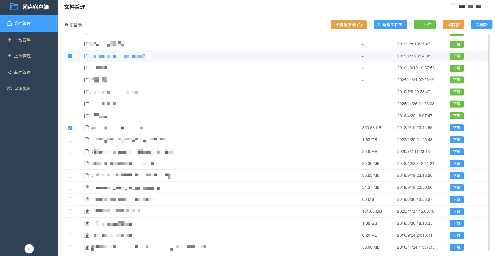

浏览和管理百度网盘中的文件和目录，支持目录导航、文件信息查看和下载操作。

#### 文件管理（加密文件显示）
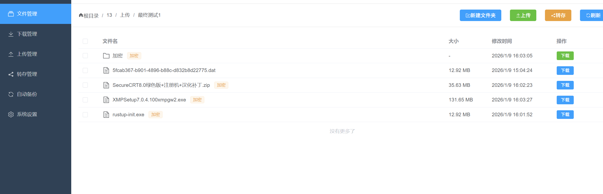

加密文件和文件夹在文件列表中会显示"加密"标签，并自动还原显示原始文件名（通过查询本地加密映射表）。下载加密文件时会自动解密并恢复原始文件名。

#### 下载管理


实时查看下载进度，支持多任务并发下载，显示下载速度、进度百分比和剩余时间。

#### 下载对话框

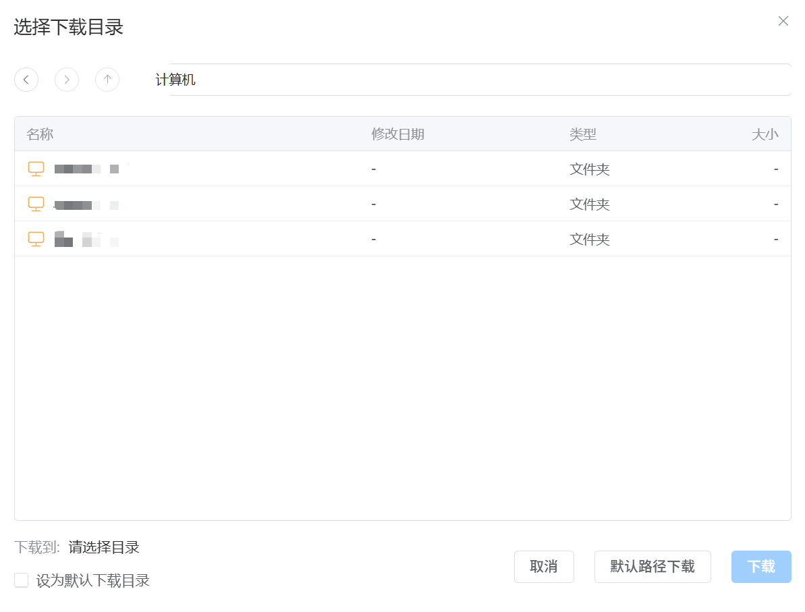

通过下载对话框确认下载任务的保存路径和任务信息，并可根据需要调整下载参数。

#### 上传管理
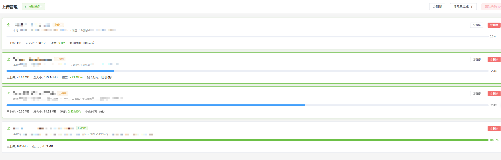

集中查看所有上传任务，实时展示进度、速度和剩余时间，支持暂停、继续和删除操作。

#### 转存管理

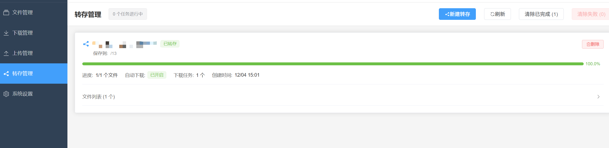

在转存管理页面集中查看所有分享链接转存任务的进度和状态，支持查看成功、失败任务，并进行删除等操作。

#### 转存弹窗


通过转存弹窗输入或粘贴百度网盘分享链接和提取码，选择转存目标目录，并发起转存任务。

#### 文件上传对话框（本地文件资源管理器）
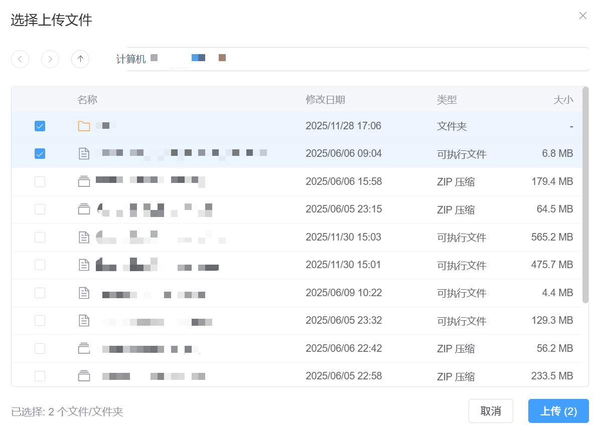

通过内置的本地文件资源管理器选择文件或文件夹上传，支持目录导航、空态/错误态提示和分页加载。

#### 上传相关系统设置
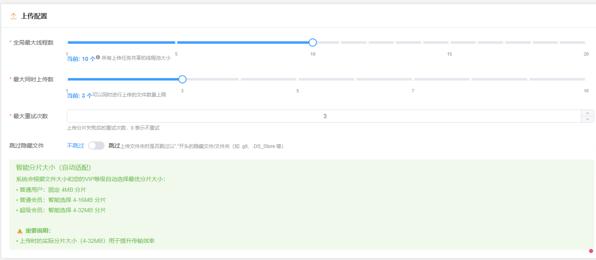

在系统设置中配置上传相关参数（如并发策略等），与下载配置统一管理。

#### 转存设置


在转存设置中配置与分享链接转存相关的参数，例如默认转存目录、是否自动在转存完成后创建下载任务等。

#### 系统设置
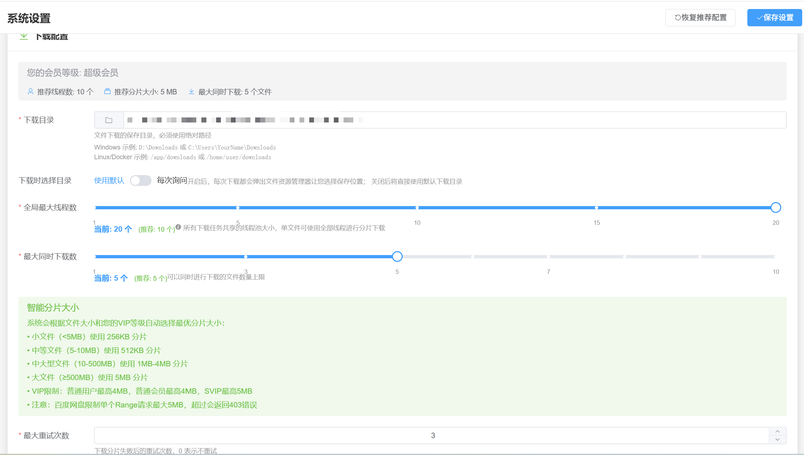

配置服务器参数和下载选项，包括线程数、分片大小、下载目录等。

#### 自动备份管理
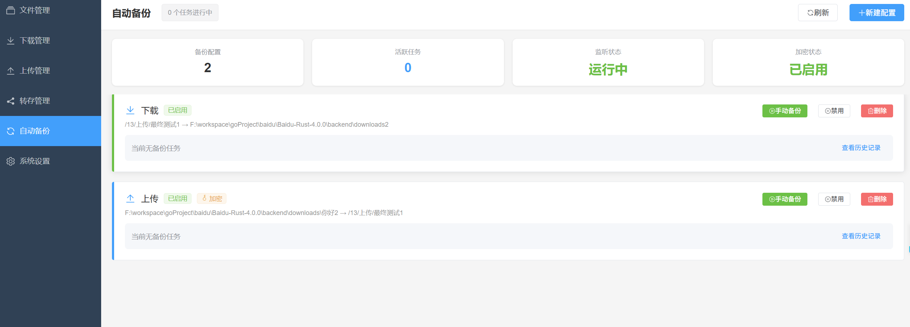

集中管理所有备份配置，查看备份状态、活跃任务数和加密状态，支持手动触发备份、禁用/启用和删除操作。

#### 自动备份设置
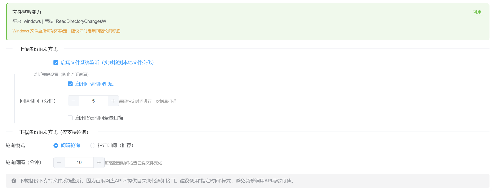

配置备份触发方式，包括文件系统监听（实时检测文件变化）、轮询兜底设置和下载备份轮询模式。

#### 加密设置
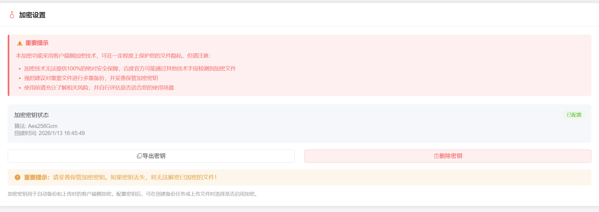

在系统设置中配置客户端侧加密，支持生成、导出和删除加密密钥，使用 AES-256-GCM 算法保护文件隐私。

#### Web 访问认证设置


在系统设置中配置 Web 访问认证，支持密码保护和 TOTP 双因素认证，防止未授权访问 Web 界面。

</details>

### 使用 Docker（推荐）

#### 方式一：使用预构建镜像（最简单）

**使用 docker run（推荐）**：

```bash
# 1. 创建必要的目录
mkdir -p baidupcs-rust/{config,downloads,data,logs,wal}
cd baidupcs-rust

# 2. 运行容器（使用预构建镜像）
docker run -d \
  --name baidu-netdisk-rust \
  -p 18888:18888 \
  -v $(pwd)/config:/app/config \
  -v $(pwd)/downloads:/app/downloads \
  -v $(pwd)/data:/app/data \
  -v $(pwd)/logs:/app/logs \
  -v $(pwd)/wal:/app/wal \
  --restart unless-stopped \
  komorebicarry/baidupcs-rust:latest

# 3. 访问应用
open http://localhost:18888
```

**使用 docker-compose**：

```bash
# 1. 创建必要的目录
mkdir -p baidupcs-rust/{config,downloads,data,logs,wal}
cd baidupcs-rust

# 2. 下载 docker-compose 配置文件
# 从项目仓库下载 docker-compose.image.yml 文件

# 3. 启动服务（使用预构建镜像）
docker-compose -f docker-compose.image.yml up -d

# 4. 访问应用
open http://localhost:18888
```

#### 方式二：从源码构建

```bash
# 1. 克隆项目
git clone https://github.com/komorebiCarry/BaiduPCS-Rust.git
cd BaiduPCS-Rust

# 2. 构建并启动服务
docker-compose up -d

# 3. 访问应用
open http://localhost:18888
```

<details>
<summary><b>📋 Docker 详细说明</b>（点击展开）</summary>

**说明**：
- Docker 容器内，后端 API 服务和前端静态文件服务运行在同一个进程中
- 只需要暴露一个端口（18888）即可访问完整应用
- 前端页面和 API 调用都通过 `http://localhost:18888` 访问
- 前端在容器内部通过 `http://localhost:18888/api/v1` 调用后端 API
- **挂载目录说明**：
    - `config`：配置文件目录，包含以下重要文件：
        - `encryption.json`：加密密钥文件
        - `baidu-pcs.db`：SQLite 数据库（历史记录、加密映射表等）
        - `autobackup_configs.json`：自动备份配置
    - `downloads`：下载文件保存目录
    - `data`：会话数据目录（登录信息、会话持久化）
    - `logs`：日志文件目录（应用运行日志，支持滚动）
    - `wal`：WAL 目录（任务持久化数据，支持断点恢复）
- ⚠️ **重要提示**：如果启用了客户端侧加密功能，请务必备份以下文件：
    - `config/encryption.json`：加密密钥，**丢失后将无法解密已加密的文件**！
    - `config/baidu-pcs.db`：包含加密文件映射表，用于解密时查找原始文件名
- 预构建镜像自动发布在以下位置：
    - [GitHub Container Registry](https://github.com/komorebiCarry/BaiduPCS-Rust/pkgs/container/baidupcs-rust) - `ghcr.io/komorebicarry/baidupcs-rust:latest`（推荐，无需额外注册）
    - [Docker Hub](https://hub.docker.com/r/komorebicarry/baidupcs-rust) - `komorebicarry/baidupcs-rust:latest`（可选，需要配置 secrets）
- 当创建 Git 标签（如 `v1.0.0`）时，GitHub Actions 会自动构建并推送 Docker 镜像
- **Linux 用户推荐使用 Docker Hub 镜像**（更通用，无需登录）：`komorebicarry/baidupcs-rust:latest`
- **如果镜像拉取较慢**，也可以从 [GitHub Releases](https://github.com/komorebiCarry/BaiduPCS-Rust/releases) 页面直接下载 Docker 镜像文件（`BaiduPCS-Rust-{版本号}-docker.tar.gz`），然后使用以下命令加载：
  ```bash
  # 下载镜像文件后，加载镜像
  docker load < BaiduPCS-Rust-v1.7.0-docker.tar.gz
  
  # 加载后可以使用镜像运行容器
  docker run -d \
    --name baidu-netdisk-rust \
    -p 18888:18888 \
    -v $(pwd)/config:/app/config \
    -v $(pwd)/downloads:/app/downloads \
    -v $(pwd)/data:/app/data \
    -v $(pwd)/logs:/app/logs \
    -v $(pwd)/wal:/app/wal \
    --restart unless-stopped \
    baidupcs-rust:v1.7.0
  ```

</details>

### macOS 使用预编译包

从 [Releases](https://github.com/komorebiCarry/BaiduPCS-Rust/releases) 下载对应架构的压缩包（Apple Silicon 选 `macos-arm64`，Intel 选 `macos-x86_64`）：

```bash
# 1. 解压（以 v2.3.3 为例）
unzip BaiduPCS-Rust-v2.3.3-macos-arm64.zip
cd BaiduPCS-Rust-v2.3.3-macos-arm64

# 2. 解除 Gatekeeper 隔离标记（必需）
xattr -dr com.apple.quarantine .

# 3. 启动（必须在解压目录内运行）
./baidu-netdisk-rust
```

然后浏览器访问 http://localhost:18888

> ⚠️ **两个注意点**
> - 预编译二进制未做 Apple 签名与公证，**跳过第 2 步会报「已损坏，无法打开」**。若仍被拦截，可在「系统设置 → 隐私与安全性」中点击「仍要打开」。
> - 程序按**当前工作目录**读取 `config/app.toml`，因此必须 `cd` 进解压目录后再启动，不要把二进制单独拷到 `/usr/local/bin` 等位置。

macOS 同样可以使用上面的 Docker 方式部署，配置与数据目录持久化更方便。


### 手动安装

#### 前提条件

- Rust 1.87（项目通过 `rust-toolchain.toml` 固定为 1.87.0，本地 / Docker / CI 保持一致）
- Node.js 18+
- npm 或 pnpm

#### 后端

```bash
cd backend
cargo build --release
cargo run --release
```

#### 前端

```bash
cd frontend
npm install
npm run build
# 或者开发模式
npm run dev
```

访问 http://localhost:5173（开发模式）或 http://localhost:18888（生产模式）

---

## 📝 平台支持说明

### 测试平台

本项目主要在以下平台进行测试：

- ✅ **Windows** - 主要开发和测试平台
- ✅ **Docker** - 容器化部署，支持跨平台运行

### 其他平台

虽然项目理论上支持 Linux、macOS 等其他平台，但**目前不会进行主动测试**。如果您在其他平台使用遇到问题，欢迎提交 Issue。

### 多平台打包

项目使用 **GitHub Actions** 进行自动化多平台构建和打包，支持：

- Windows (x86_64)
- Linux (x86_64, ARM64)
- macOS (x86_64, ARM64)

预编译的二进制文件可在 [Releases](https://github.com/komorebiCarry/BaiduPCS-Rust/releases) 页面下载。

---

## 🛠️ 技术栈

### 后端

- **语言**: Rust 1.87
- **框架**: Axum 0.7（Web 框架）
- **异步运行时**: Tokio
- **HTTP 客户端**: Reqwest
- **序列化**: Serde + Serde JSON
- **日志**: Tracing

### 前端

- **框架**: Vue 3（Composition API）
- **语言**: TypeScript 5
- **构建工具**: Vite 6
- **UI 库**: Element Plus
- **状态管理**: Pinia
- **路由**: Vue Router 4
- **HTTP 客户端**: Axios

### 部署

- **容器化**: Docker + Docker Compose
- **多阶段构建**: 优化镜像大小
- **健康检查**: 自动故障检测

---

<details>
<summary><b>📁 项目结构</b>（点击展开）</summary>

```
BaiduPCS-Rust/
├── backend/                # Rust 后端
│   ├── src/
│   │   ├── auth/          # 认证模块
│   │   ├── netdisk/       # 网盘 API
│   │   ├── downloader/    # 下载引擎
│   │   ├── uploader/      # 上传引擎
│   │   ├── transfer/      # 转存模块（分享链接转存）
│   │   ├── common/        # 公共模块（CDN刷新检测等）
│   │   ├── filesystem/    # 文件系统访问模块
│   │   ├── config/        # 配置管理
│   │   ├── server/        # Web 服务器
│   │   └── sign/          # 签名算法
│   └── Cargo.toml
├── frontend/               # Vue 3 前端
│   ├── src/
│   │   ├── views/         # 页面组件
│   │   ├── components/    # 公共组件
│   │   ├── api/           # API 封装
│   │   ├── stores/        # Pinia 状态
│   │   └── router/        # 路由配置
│   └── package.json
├── config/                 # 配置文件示例
│   ├── app.toml.example
│   └── config.example.json
├── scripts/                # 构建脚本
│   ├── build.sh
│   ├── deploy.sh
│   ├── dev.sh
│   └── test.sh
├── tests/                  # 测试脚本
│   ├── integration_test.sh
│   └── performance_test.sh
├── Dockerfile              # Docker 镜像
├── docker-compose.yml      # 生产环境
├── docker-compose.dev.yml  # 开发环境
├── rustfmt.toml            # Rust 代码格式配置
├── .gitignore              # Git 忽略文件
├── LICENSE                 # Apache License 2.0
└── README.md               # 项目说明
```

</details>

---

## ⚙️ 配置

配置文件位于 `backend/config/app.toml`:

```toml
[server]
host = "127.0.0.1"
port = 8080
cors_origins = ["*"]

[download]
download_dir = "downloads"
max_global_threads = 10
max_concurrent_tasks = 2
chunk_size_mb = 10
max_retries = 3
```

<details>
<summary><b>📋 配置参数说明</b>（点击展开）</summary>

#### 下载配置参数

- **`max_global_threads`**: 全局最大线程数（所有下载任务共享的并发分片数）
- **`max_concurrent_tasks`**: 最大同时下载文件数
- **`chunk_size_mb`**: 每个分片的大小（单位: MB）
- **`max_retries`**: 下载失败后的最大重试次数

#### 普通用户配置建议

普通用户请将**全局最大线程数**（`max_global_threads`）和**最大同时下载数**（`max_concurrent_tasks`）都设置为 1。

```toml
[download]
max_global_threads = 1
max_concurrent_tasks = 1
```

**⚠️ 注意**：调大线程数只会在短时间内提升下载速度，且极易很快触发限速，导致几小时至几天内账号在各客户端都接近 0 速。

#### SVIP 用户配置建议

SVIP 用户建议**全局最大线程数**（`max_global_threads`）设置为 10 以上，根据实际带宽可调大，但不建议超过 20。可以配合**最大同时下载数**（`max_concurrent_tasks`）调整，**注意最大同时下载数越大不代表速度越快**。

```toml
[download]
max_global_threads = 10    # 建议 10-20
max_concurrent_tasks = 2    # 可根据需求调整
```

</details>

---

## 🧪 测试

```bash
# 运行所有测试
./scripts/test.sh

# 后端测试
cd backend
cargo test

# 集成测试
./tests/integration_test.sh

# 性能测试
./tests/performance_test.sh
```

---

## 📈 性能指标

| 指标 | 数值 |
|------|------|
| Docker 镜像大小 | ~150MB |
| 启动时间 | 5-10 秒 |
| 内存占用（空闲） | 100-200MB |
| 内存占用（下载） | 200-500MB |
| 并发下载分片 | 最多 16 个 |

---

## 🗺️ 路线图

- [x] ✅ 基础架构
- [x] ✅ 认证模块（二维码登录）
- [x] ✅ 文件浏览
- [x] ✅ 下载引擎（多线程 + 断点续传）
- [x] ✅ Web 服务器（RESTful API）
- [x] ✅ 前端界面（Vue 3）
- [x] ✅ Docker 部署
- [x] ✅ 文件夹下载（目录下载）
- [x] ✅ 批量下载（多文件选择下载）
- [x] ✅ 批量上传（多文件/文件夹上传）
- [x] ✅ 上传功能
- [x] ✅ 百度网盘新建文件夹功能（⚠️ 可能需要重新登入才可使用）
- [x] ✅ CDN链接刷新三层检测机制（速度异常检测、线程停滞检测、定时强制刷新）
- [x] ✅ 转存分享链接功能
- [x] ✅ 上传下载最近目录记忆
- [x] ✅ 下载文件资源管理器
- [x] ✅ 任务持久化
- [x] ✅ WebSocket 实时推送与心跳/重连
- [x] ✅ 日志持久化与滚动
- [x] ✅ 移动端适配
- [x] ✅ 自动备份
- [x] ✅ 客户端侧加密（支持普通上传和自动备份）
- [x] ✅ Web 访问认证（密码保护 + TOTP 双因素认证）
- [x] ✅ 离线下载功能（支持 HTTP/HTTPS/磁力链接/ed2k，自动下载，智能轮询）
- [x] ✅ 网络代理支持（HTTP/SOCKS5 代理，支持认证、测试连接、运行状态监控、自动回退）
- [x] ✅ 批量任务操作（下载/上传任务批量暂停/继续/清除）
- [ ] 📝 下载/上传 SSD 缓冲区（针对 NAS 用户：① 减少 HDD 活跃时间，让硬盘更多休眠；② 提升传输效率，仅网速 > 磁盘速度时有效）

---

## 🤝 贡献

欢迎贡献代码！请遵循以下步骤：

1. Fork 本仓库
2. 创建特性分支 (`git checkout -b feature/AmazingFeature`)
3. 提交更改（提交信息遵循 [Conventional Commits](https://www.conventionalcommits.org/)，例如 `git commit -m 'feat: add some amazing feature'`）
4. 推送到分支 (`git push origin feature/AmazingFeature`)
5. 开启 Pull Request

### 开发规范

- **Rust**: 遵循 Rust 官方代码风格（使用 `cargo fmt` 和 `cargo clippy`）
- **TypeScript**: 遵循 Vue 3 最佳实践
- **提交信息**: 遵循 [Conventional Commits](https://www.conventionalcommits.org/) 规范（`feat`/`fix`/`docs`/`chore` 等）；PR 标题与每个 commit 都会被 CI 校验

---

## 📄 许可证

本项目采用 Apache License 2.0 许可证 - 详见 [LICENSE](LICENSE) 文件

---

## ⚠️ 免责声明

本项目仅供学习和研究使用，请勿用于商业用途。使用本工具产生的任何问题与本项目无关。

---

## 🙏 致谢

- [qjfoidnh/BaiduPCS-Go](https://github.com/qjfoidnh/BaiduPCS-Go) - 本项目的重要参考
- [GangZhuo/BaiduPCS](https://github.com/GangZhuo/BaiduPCS) - 原始项目灵感来源
- [Rust 社区](https://www.rust-lang.org/)
- [Vue.js 社区](https://vuejs.org/)
- [Element Plus](https://element-plus.org/)

---

<div align="center">

**⭐ 如果这个项目对你有帮助，请给一个 Star！**

Made with ❤️ by Rust + Vue 3

</div>
